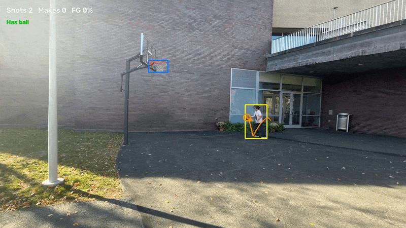
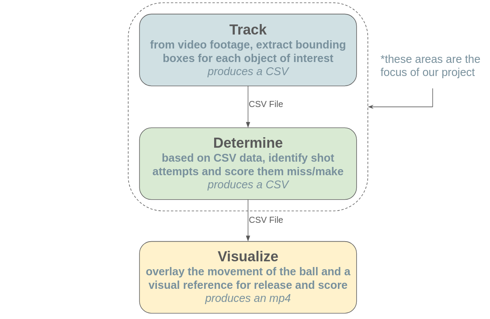
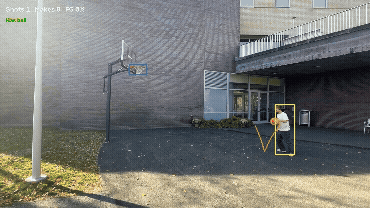
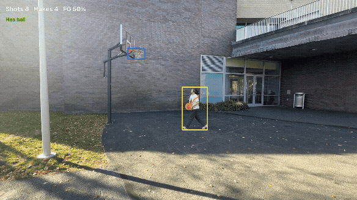

# Basketball Stat Tracker - Computer Vision Project

  

Ellie Kung and Enzo Smajlaj

  

For Olin ENGR3590 Computational Introduction to Robotics

  

This README exists as an explanatory overview of general computer vision principles, the YOLO-World and YOLOE models, and ByteTrack. It also acts as documentation, through descriptions of implementation and experimentation, for the basketball stat extraction project. Instructions for how to run and use the repo are also shown below.

  

## Project Overview

  

The aim of this project was, given footage of either an individual or multiple individuals playing basketball, extract a "stat-sheet", a document containing information of each player's contributions and interactions within the game, as well as provide a visual layer on top of said footage. To this extent, we managed to construct a field goal percentage tracker for a singular player based on hand-held phone footage. The system reports every shot attempt, defined as the ball reaching rim height near the hoop, along with the moment the ball was released and player possession. This project was developed on and tested against two videos of a single shooter attempting shots at a basket titled *layups* and *shots*, and further tested on a third video with two players titled *lgrac*. The program’s findings were evaluated against hand-made labels based on the footage.

  

<p align="center"></p>
<p align="center"><em>Figure 1: The visualization layer on a made shot.</em></p>

  

## Approach

  

### System Overview

  

We designed the project with three main checkpoints. First, there is the Track phase. From footage, we produce a CSV that stores each detected object and its bounding box for each frame in the video. Following this is the Determine phase. From the CSV of all the bounding boxes, we create a new CSV which holds the path of the ball, when a shot is released and whether it misses or makes the bucket. Once the processing steps are over, we have the final phase, Visualization. This phase takes the previous CSV as well as the original footage to create an MP4 video file which shows the bounding boxes, relevant paths, a stat tracker, and whether each basket is a make or a miss.

  

This is further detailed in Figure 2 below, showcasing our system architecture diagram:

  

<p align="center"></p>
<p align="center"><em>Figure 2: System architecture. The three phases communicate only through CSV files.</em></p>

  

We selected this architecture as it allowed for a clean separation of each program. By having each phase communicate through CSV files, it allows a higher speed of iteration and delineation of debugging. Given that the Track phase requires intense usage of our machine’s hardware, running the neural network on our footage took about 40 minutes. Given this, it would be a large detriment to repeat this process per new modification; however, by producing a CSV per run, we decouple the analysis, which would require much more modification than other areas, from the tracking, allowing us to modify shot logic and rerun many times without repeating detection work that has already existed. Additionally, each phase controls purely that section, meaning something like visualization cannot represent a modified decision, so if something were to appear incorrect from the result at this stage, the result being wrong is purely in the Determine phase. Overall, this helped us greatly in our debugging and also task distribution with each section having clear boundaries and predefined integration steps.

  

Table 1 below details the files passed between each phase.

  
*Table 1: Files passed between phases.*

| File         | Written by | One row per  | Columns                                                        |
| :----------- | :--------- | :----------- | :------------------------------------------------------------- |
| `tracks.csv` | Track      | detected box | frame, track ID (unused), class, confidence, x1, y1, x2, y2    |
| `shots.csv`  | Determine  | shot attempt | shot number, release frame, rim frame, exit frame, result, fps |
| `frames.csv` | Determine  | video frame  | drawn ball center, hoop box, player box, possession flag, fps  |


### Data

  

We filmed the first two videos ourselves on the outdoor Olin basketball hoop using an iPhone held by hand. The third video, *lgrac*, was recorded indoors at the Babson LGRAC with two players. This footage was tested after the classifier had been developed, though its results led to one change in the make rule (see Testing & Verification).

  

The following table (Table 2) showcases the parameters of all videos.

  

*Table 2: The three videos used for development and testing.*

| Property              | *shots* (`IMG_5768`)                                                                                                | *layups* (`layups.mov`)                                                                            | *lgrac* (`lgrac.mp4`)                                                                                                              |
| :-------------------- | :------------------------------------------------------------------------------------------------------------------ | :------------------------------------------------------------------------------------------------- | :--------------------------------------------------------------------------------------------------------------------------------- |
| Length and frame rate | 83 s at 60 fps (4,968 frames)                                                                                       | 100 s at 30 fps (2,987 frames)                                                                     | 60 s at 30 fps (1,790 frames)                                                                                                      |
| Resolution            | 1920 × 1080                                                                                                         | 1920 × 1080                                                                                        | 848 × 480                                                                                                                          |
| Setting and players   | outdoors, one player                                                                                                | outdoors, one player                                                                               | indoors, two players                                                                                                               |
| Shot attempts (makes) | 10 (2)                                                                                                              | 14 (5)                                                                                             | 13 (4)                                                                                                                             |
| Notable difficulties  | the shooter's orange pants are the same color as the ball; real basketballs are visible in background | smaller, blurrier ball; the net never fully hides the ball; people walk through the background | low resolution; a browner ball on a wooden floor of similar hue; a second player; misses that drop behind the net are hidden by it |

  

Learning from previous projects, lighting is super important because it gives different colors more contrast, allowing the computer vision models to distinguish things more easily, so we took videos on sunny days, when the sun was high in the sky. The Olin hoop was chosen because it was close to where we were working and allowed us to take multiple videos. The net was also in good condition, so we could rely on it to slow the ball down and redirect any shots that weren’t super arced (coming down from straight above) to fall out of the hoop at a consistent position. Minimizing stray objects, like extra people and balls, was done so that the model could easily know who to focus on. However, we also added features to our code, such as making sure we were only tracking the ball closest to the hoop and identifying which person had the ball, in order to minimize effects of extra balls and people.


The side view was chosen as it resulted in a reasonable testing environment along with integrating with existing technologies well. Most models are trained on footage of people viewing them from a similar height, so a complete birds-eye view would remove the accuracy from the model. If we were to move forward in that direction, it would require us training our own model to identify people, as well as redefining the entire problem from above, meaning a different rim detection method. Additionally, we wouldn't be able to make use of the net in terms of extracting ball position. However, one of the largest issues with this approach is getting the footage itself, as we would not have a clear surface to place our camera directly above and would have to rely on the balconies around the Olin hoop for most of our footage. Similarly, the side view is superior to the front view when considering the tendencies of players. Most individuals prefer to shoot facing towards the basket itself, meaning a front view would be more likely to be obscured by the player themselves. From this, there would be fewer opportunities to extract information about the ball relative to the hoop, as airballs, or having an accurate shot with minimal power, would be less observable from a front-view than a side view and introduce more complexity. Additionally, a rear view would also make the ball detection harder as individuals are more likely to keep the ball towards the front of their body, meaning they would act as a barrier between camera and ball, obscuring the detection. However, one vulnerability of the side view is that ball detection would vary in accordance with someone's dominant hand, as they are more likely to keep the ball on that side. Additionally, the backboard has a signature look from the side that would likely modify the detection from the YOLOE model to include more than just the rim itself. 
  

### Track

  

From a high level, fundamentally, the goal of computer vision is to extract semantic information from camera data. Object detection refers to extracting a list of outputs from the camera information, generally in the form of a bounding box, a class, and a confidence value. Camera data is stored in pixels, and while the exact pixel intensities are not sufficient for complex detection, the spatial and temporal relationships between these pixels can provide unique insights into extracting necessary information for object detection. For instance, a basketball can contain different pixel information across varying lighting conditions, motion, and environment interactions, such as being partly covered by a hand. Consequently, the detection requires information about the region of interest that changes little with the object’s visual appearance and is more directly linked to the object itself. This information is often referred to as the features of an image, and much work is being done on enhancing feature extractors. To accomplish this, models perform a series of convolutions. A convolutional filter is a small array of weights, or a kernel, that are applied across every position in an image, where at each position, the filter multiplies the input values (as in pixel intensity values from the image) by the kernel and sums the products. Applying one filter across the image produces a two-dimensional map of how intensely the kernel’s pattern is present at each location. A convolutional layer applies many filters at once and merges their maps into a feature map with a channel per filter. Given that these same weights are universally applied across the image, the pattern detection is uniform across the image, which makes detection a valuable application of convolution as regions of interest can exist anywhere within the frame.

  

One issue, however, is that the size of your kernel array dictates the scale of patterns that can be detected, i.e., a 3x3 matrix can only detect patterns that are three pixels long. To solve this, deeper convolutional layers operate on the previous feature maps themselves. Stacking the layers like this means that each new layer is essentially building on the information of the previous layer, so that the first pass, which might extract edges, could form into lines, which could form into shapes as each layer is later built. However, operating on the same resolution at all points does not quickly increase the area of interest’s information, which is why these algorithms will downsample. This lets each subsequent kernel cover a proportionally larger region of the input, letting the features cover larger areas, and in turn reducing computational overhead.

  

With this, one major decision is the weight of each kernel. These weights are generally learned rather than chosen by hand. The network goes through a series of predicting boxes for images whose correct boxes are known, a loss function is used to calculate the error, and the weights go through an adjustment to reduce the loss until it reaches a plateau. Over a large dataset, such as the COCO dataset [1] the YOLO models train on, the filters converge to finding whichever patterns are useful for separating the classes from the background.

  

Taken together, the track phase, which is entirely in [`track_yoloe.py`](track_yoloe.py), runs an off-the-shelf object detector on every frame and writes each detected object, which is our ball, hoop, and person, to `tracks.csv`. This section explains how YOLO in particular works, our process for determining the detector, and the parameters selected for this model and why.

  

YOLO, from the acronym “You Only Look Once” [2], is a one-stage detector: rather than first proposing candidate regions and then classifying each one, it predicts every box and score in a single pass of one network (treating the frame analysis as “only look[ing] once”).

  

The YOLO11 models [3] we used, and the YOLOE models [4] built on them, consist of three main parts: a backbone, a neck, and a head.

  

The backbone is dubbed as such as it serves as the feature extractor described earlier, which feeds the rest of the detection process. It is a stack of convolutional layers that convert the given image into a feature map at several levels of granularity, or differing resolutions. Early layers, which are of a higher resolution, respond more to edges and textures, while deeper layers respond more intensely to larger shapes. The backbone would output the feature maps at varying resolutions.

  

Following this is the neck, which is a feature pyramid that combines the coarse, semantic maps with the finer, more detailed maps so that small objects are described with detail and context. A low-resolution map could know a region contains a ball-like object but cannot localize it to within a ball’s width. The feature pyramid of the neck [5] resolves this via a top-down pass, with a series of upsampling from the low-resolution maps and combining them with the higher-resolution ones, with a final bottom-up pass [6] which downsamples the newly concatenated maps with the low-resolution maps once again so that the benefits of the two resolutions come together.

  

The final element is the head, which converts each of the neck outputs into predictions. All positions, or cells, from each map exist as a potential candidate for detection of an object near it. This head is decoupled, meaning separate branches of convolutions predict the box and class scores, since localizing an object and recognizing it benefit from different features. For the box extraction, each cell predicts the distances from its center to the four edges of the theoretical optimal box, in units relative to the map's resolution. Each distance exists as a probability distribution [7], which allows the network to express varying levels of certainty in the guess of the bounding box values.

  

Given that many neighboring cells would represent the same object, the raw output from this stage contains many overlapping boxes; consequently, the algorithm employs non-maximum suppression [8] to remove all overlap by keeping only the highest-scoring box and discarding any box that overlaps with the maximally confident’s bounding box exceeds a certain threshold. This is done via a setting while running (`agnostic_nms=True`), since we chose two prompts that represent the same idea (“basketball” and “orange ball”, which both produce a box on the same ball where only one box should be kept), though the standard implementation is generally per-class.

  

The network resizes each frame to a fixed input size before processing. This directly impacts the ability of the network to detect small objects, such as our basketball. The original inputs, as mentioned earlier, are at 1920 pixels wide. At the default input size of 640 pixels, each frame is only a third of its original size, meaning the ball, which is about 25 pixels wide in the original, becomes just 8, mapping to a single cell on the finest grid; however, at 1280 pixels, that same ball would cover two cells, leading to a great accuracy increase with that additional information.

  

In the description of the system’s head, the score of a class is computed from the cell’s feature vector, derived from the learned weight vector’s values. Since these vectors are fixed when training ends, the set of classes they can work under is fixed as well. The traditional YOLO models are trained on the COCO dataset, meaning there exist only 80 fixed classes that the model is able to extract from a given image. In our case, the classes of interest were originally “person” and “sports ball”; however, there was no simple hoop or basketball detection.

  

Open-vocabulary detectors tackle this problem by introducing a comparison between images and prompted text. For each predicted box, the model head outputs an embedding, which is a vector with the entries corresponding to descriptions of that space on the image, referring to the extracted features. New to this approach, a text encoder applies the same process to the input prompt, which has been trained to take the prompt, such as basketball, and pair that with a similar embedding vector in the same space as the image embedding vector. With these two vectors, the similarity of the two represents the score for the box mapped to the prompt, meaning two vectors that align between image and text will likely refer to the same concept. With this approach, any phrase can exist as a class, as opposed to the restricted 80-class set from the COCO dataset. These text encoders are derived from CLIP-style models [9], which are trained on large collections of image-description pairs. This allows them to place images and prompts near one another in the shared space.

  

We ended up comparing two open-vocabulary detectors: YOLO-World [10] and YOLOE [4]. YOLO-World employs the CLIP embeddings directly into the neck with the purpose of computing the image features with the text prompts in mind. This looks like reweighing the image features at each level by their similarity to the prompts in that shared space. YOLOE leaves the original backbone and neck unchanged and introduces the text only in the head. Its text prompts go through RepRTA (re-parameterizable region-text alignment), a residual network that refines the MobileCLIP [11] text embeddings to better match the detector’s region embeddings.

  

To analyze the performance of these three models, we looked at a slew of metrics. This included the general category of accuracy, and specifically things like precision and recall, as well as speed. Precision is the percentage of positive predictions that were actually positive, and recall refers to the percentage of positive instances that were predicted. Generally, we found that the original YOLO model with “sports ball” could only find the ball in around 25% of frames, which prompted us to look elsewhere. Between YOLO-World and YOLOE, the difference in accuracy was of a lesser extent. This was done by an eye-test and YOLOE was chosen as it was more likely to have a valid detection of the ball. The speed between the two models was also similar, as each run for both models took about 40 minutes for our footage.

  

One element that the prompted class detection gives is the range of classes that can exist; simultaneously, this drastically increased the search space of what an optimal prompt could be. For instance, our original prompt of “backboard” and “basketball rim” had very poor detection and were only valid for an estimated 5% of footage; however, we switched to “basketball hoop”, which has a jump in accuracy to being detected nearly 100% of the time for the shots footage but around 70% for the layups footage. After some testing with different models, this frame percentage didn’t fluctuate much, but swapping the prompt to “basketball hoop with net” bumped the detection to nearly 100% for both videos, as well as raising the median confidence for the class. The more closely the prompt describes what is visible in the region of interest, the closer its embedding lies to the embedding of that region. To an extent, this allows for more detailed classes, though we did not rely on such detailed prompts in our analysis, as the detections were not clean enough and doing so would blur the line between our Track and Determine phases.

  

Additionally, after we had primarily focused on YOLOE, we realized there existed a modern version of YOLOE-26, though our tests reported far fewer hoop detections. Upon further inspection, this was due to the fact the confidence threshold was not being met; at that point, no further testing was deemed necessary as the YOLOE-11 detection had nearly saturated the video.

  

With this, our detectors treat each frame independently, meaning we gain knowledge of where objects are in space but lack the temporal element of relationships between one frame and the next. Establishing this relationship is necessary to understand the event of interest as they occur across frames. Many modern implementations of this tracking from detection use a procedure where they predict where the next detection should be, based on information from the current frame, and match the next frame’s information to that prediction to create a string of detections that are considered together.

  

The most common form of prediction is the Kalman filter [12]. The Kalman filter applies a linear motion model, meaning each quantity changes at a constant rate. In tracking, these quantities are the center, aspect ratio, and height of a box, along with the rate of change of each. The filter then maintains an estimate and covariance which are continuously updated with the step below. The state of each track is given by $`\mathbf{x} = (c_x, c_y, a, h, \dot{c}_x, \dot{c}_y, \dot{a}, \dot{h})`$, which maps onto the values from earlier. The filter keeps an estimate $`\hat{\mathbf{x}}`$ and its covariance $`P`$, a measure of its uncertainty, and alternates between predicting and updating:

```math
\hat{\mathbf{x}}^- = F\hat{\mathbf{x}}, \qquad P^- = F P F^\top + Q \qquad\qquad (1)
```

```math
K = P^- H^\top (H P^- H^\top + R)^{-1}, \qquad \hat{\mathbf{x}} = \hat{\mathbf{x}}^- + K(\mathbf{z} - H\hat{\mathbf{x}}^-), \qquad P = (I - KH)P^- \qquad\qquad (2)
```

Here $`F`$ updates each quantity by its rate of change over one frame (meaning a constant-velocity model), $`Q`$ is the uncertainty added by that model, $`\mathbf{z}`$ is the measured box, $`H`$ selects the box from the state, and $`R`$ is the measurement noise. The Kalman gain $`K`$ weighs the prediction against the measurement according to their uncertainties.

  

With this information, the predicted boxes are then matched to the given boxes via minimizing the cost across all pairs, with a cost function described by the overlap between the bounding boxes. To do this effectively, the Hungarian algorithm [13] is often employed.

  

Taken together, these two methods of prediction and matching allow us to create tracks of each class from our detection, providing information on where the item is and the trajectory it follows. One standard tracker that implements this, available through Ultralytics [3] for ease-of-use, is ByteTrack [14]. ByteTrack builds on top of this, however, by introducing two stages for the matching. This allows a high-confidence pass to occur, and any detections that are of a lower confidence threshold are kept temporarily. Once the initial matching occurs, any unmatched tracks are mapped onto low-confidence detections, which serves to string together tracks even if there is some occlusion for the class of interest.

  

Despite this, we found that implementing ByteTrack on our footage did not provide accurate tracking. Generally, this worked fine on the hoop and person tracks, which comes from the fact that the person and hoop bounding boxes are large and do not carry large velocities; in contrast, the ball is relatively much smaller and also moves quickly. This means that the region overlap between frames was not sufficient to continue the track and many instances of the ball were dropped. Consequently, we did not end up using ByteTrack for our purposes and instead chose to have another method of tracking between frames. This also provides further information for determining the exact instance a shot could be considered released. This speaks to a larger problem that would have existed for our project had we attempted it called re-identification, which suggests that despite making tracks for the same class, there must be further information to discern objects within that class. For instance, on the *shots* footage, whose higher frame rate makes the ball move less per frame, ByteTrack did form tracks on the ball but gave it a new “ID” each time a track was lost, producing 58 IDs for the same ball. For a project attempting to assign statistics to an individual player, 58 interpretations of the same ball would cause great trouble. Given that knowledge, we did not deem it in scope for our project as we worked.

  

One of the limitations of prompt-based detection is that some concepts are rarely represented in the training data and prove difficult to detect. For instance, we had attempted to introduce the prompt “basketball in the net” to see if the model had the ability to accurately detect when the ball would be in the net, allowing much of the determine logic to be based on this detection; however, there were many false-positives as the detector highlighted the hoop with no ball as our “basketball in the net”.

  

With this, the foundation of the project exists purely as a CSV that is exported after running the model across all the frames of our footage that all of the determined logic and tracking utilizes.

  

### Determine

  

For the determine phase, we start with a CSV of each detected object (ball, hoop, and person) along with their bounding boxes. From this, the goal is to create a new CSV of shot attempts, with each attempt’s release and exit frames, as well as the shot’s result, with a second CSV of per-frame information purely for visualization purposes.

  

In order to process this data, we identified individual ball trajectories, identified potential shots, and then classified each potential shot. Prior to this analysis, there was some preprocessing for the information. Given the nature of our handheld footage, the camera experienced frequent movement, which paired with the inconsistent determination of the rim’s bounding box to also include the backboard, required smoothing on the hoops’ position in the frame. Additionally, to make the logic scale-invariant, meaning it could be applied to footage from any distance from the hoop, all coordinates were instead represented in a different system where instead of pixels as our unit, we measured objects in hoop widths, which essentially describes the ball’s position relative to the now smoothed hoop. All of the logic presented below is written programmatically in [`stat_tracker_alt.py`](stat_tracker_alt.py). The parameters for this file can be found below the logic, in the Parameters section.

  

To execute the hoop smoothing and coordinate conversion, we employed a median filter, meaning we take the median across samples. This is less responsive to outliers in the data as the median would entirely discard their entries, as opposed to an alternative approach, such as the mean. To this extent, we applied a general shape filter, which means that the aspect ratio of the hoop’s bounding box must be within 0.5 to 0.8 (as defined by `HOOP_SHAPE`). The net makes the rim’s bounding box more vertical than horizontal, so this means any bounding box that escapes this aspect ratio is more likely to have included the entire backboard, which provides incorrect information about the rim’s center position, which the rest of the shot logic relies on. The median smoothing is implemented via replacing each box edge by the median across +-0.25 seconds (as defined in `HOOP_SMOOTH_S`). If no hoop is detected, then the previous hoop position is carried forward, which is made under the assumption the footage is attempting to keep the scene in focus, i.e., there will not be sudden intense jumps besides the shakiness from the handheld aspect. The scale-invariant coordinates were implemented via a simple transform applied to the pixel coordinates of the extracted bounding boxes. The equation for this is shown below:

  

```math
u = \frac{x_{\text{ball}} - x_{\text{hoop center}}}{w_{\text{hoop}}}, \qquad
v = \frac{y_{\text{ball}} - y_{\text{hoop top}}}{w_{\text{hoop}}} \qquad\qquad (3)
```

  

Where u is the sideways offset from the center of the rim and v is the distance below the rim, meaning negative values are above it.

  

Because the hoop box spans the rim, the edges of the rim lie at u = +-0.5, which is used for shot detection; one other feature of using the hoop to introduce invariance is that the rim is of a known size, so if needed, everything relative to the rim could be converted into actual units.

  

#### Identifying Ball Trajectories

  

Based on the initial CSV, we know whether and where a ball was detected in each frame. Using this information, we can track each individual ball’s bounding box to find its center location. The center location is used to find the path of the ball so that when there are multiple balls, we can determine which ball is the one we should keep track of. With this, however, there are two things that must be done before the trajectory can be finalized - removing irrelevant, stationary balls, and describing a means to determine which detections in successive frames represent the same ball.

  

For the irrelevant balls, we noted that the footage contains balls in the background that were stationary. Despite the accurate portrayal of a ball in the frame, these are not desirable as they are not in-use for the game itself. Consequently, we remove them based on the stationary behavior, which is done through an occupancy histogram across the footage’s runtime. In `fixed_spots()`, the frame is divided into squares 0.1 hoops wide (defined by `FIXED_SPOT_SIZE`) and then each second of video in which a square has a ball is compiled. If a square contains a ball for more than 40% of the footage (defined by `FIXED_SHARE`), that square is considered marked. With this, `ball_candidates()` then discards balls that are in a fixed square, which removes the balls from the background in *shots*.

  

Those remaining detections post-filtering are then grouped into paths, with one path existing per object. The implementation of this algorithm closely matches ByteTrack, grounded in the prediction and matching phases, but introduces some various differences for increased accuracy for our purposes.

  

Each path, in the `BallPath` object, stores its most recent position and a velocity. Given this, we can describe a predicted position as:

  

```math
\hat{\mathbf{p}} = \mathbf{p} + \dot{\mathbf{p}}\,\Delta t \qquad\qquad (4)
```

  

Unlike ByteTrack’s Kalman filter, where every new track instantiates zero velocity, a path takes its velocity after only two detections, so a fast ball is predicted more accurately.

  

One issue with this approach is a potential change of velocity introduced at the same frame the prediction takes place. To counteract this, there is a window around the prediction that defines the reach of that prediction beyond the singular point that's calculated. This is described by the equation:

  

```math
\text{reach} = \text{BOX\_JITTER} + \text{MAX\_SPEED\_CHANGE}\cdot\Delta t \qquad\qquad (5)
```

  

In this equation, $`\Delta t`$ is the time since the path was last detected, `MAX_SPEED_CHANGE` represents the allowable variation in speed, and `BOX_JITTER` allows for some error in the detected center which will always be present. Because the reach grows with the time since the last detection, this also allows us to account for the effect of gravity, which would remove the constant velocity during the airtime of the ball. A path with only one detection has no velocity, so the `MAX_SPEED_CHANGE` is supplemented with `BALL_MAX_SPEED`.

  

For each frame, the program has three steps for matching. Every path within the last 0.5 seconds (as determined by `PATH_LOST_S`) computed its predicted position, and with that, the feasible reach. Then, every pair of detection and path whose distance is within the path’s reach are collected, and are ordered by increasing distance with each element only used once. This is a greedy approach as every detection is mapped to the closest track, but it is reasonable given that the balls of a similar trajectory after sampling will be near one another. Each detection that remains unassigned is the start of a new path. This metric of using the distance between centers replaces the bounding box overlap that was discussed prior. Additionally, bounding the change in velocity prevents stale ball detections from mapping onto the tracks.

  

From this set of paths, the program derives two unique sequences with one ball per frame. In each frame, it takes the most confident ball within a region around the hoop, defined as |u| < 1.5 and -1.5 < v < 2.5 (defined by `HOOP_ZONE_U` and `HOOP_ZONE_V`) and leaves the frame empty otherwise. This is important as stale balls that could pass through would not contain the same level of motion blur as a travelling ball and likely be the most confident in the frame. In practice, when the real ball was hidden in the net, the most confident ball in the frame was often a stationary orange object 3 to 9 hoop widths away. It is also logical that a shot is known only when it is near the rim. This is written into `hoop_balls()`. Similarly, `ball_to_draw()` is defined purely for visualization, where it follows a single path and bridges gaps by taking the nearest detection.

  

#### Identifying Potential Shots

  

The goal of the determine phase is to take the continuous detection data and discretize it into events. The general method is to define this event as a threshold over the frame, i.e. the moment a signal, or ball position, enters a region, and then merge the entries that occur close together in time. This lends itself to two main things to balance, where the size of the region of interest trades greater event detection for increased false positives, and a longer merging time window blends events that were unique against potentially cutting a singular event into two entries.

  

`find_shots()` defines a shot attempt as the ball reaching the height of the rim near the hoop. This ball is considered at rim height when three conditions are met - it must be less than 0.45 hoop widths below the top of the rim (defined by `RIM_V`), it must be within one hoop width of the rim’s center horizontally (defined by `RIM_U`), and it must be detected with a confidence of at least 0.2 (defined by `RIM_CONF`, with the intent to exclude the orange rim bracket detections). Consecutive rim-height frames separated by less than 0.75s (defined by `SAME_SHOT_S`) are merged into a single attempt, which aims to capture the ball bouncing above rim after a missed shot as included in that same attempt. Each attempt records its first and last rim-height frames.

  

To find the release of a shot, we defined it as the last moment at which the shooter is in contact with the ball prior to a shot being detected. Since the detector does not observe contact, it is purely inferred from the relative positions of the ball and person.

  

`find_release()` determines when the ball left the shooter’s hands, so it will walk backwards along the ball’s path from that first rim-height frame, for at most three seconds (defined by `RELEASE_LOOKBACK_S`), to the most recent frame in which a person held the ball. This method implies that the program cannot exist as a realtime solution, as we utilize the time from when the shot is first detected at the rim, which has a reliable time, and retroactively search backwards in time for the last frame in which the ball was held. Holding the ball is defined by the position of the ball relative to the person's bounding box. `Box.holds()` analyzes when the ball’s center lies within the person’s box, with an additional margin $`m`$ on the sides and top:

```math
x_1 - m \le x_{\text{ball}} \le x_2 + m, \qquad y_1 - m \le y_{\text{ball}} \le y_2, \qquad m = \text{HOLD\_MARGIN}\cdot w_{\text{person}} \qquad\qquad (6)
```

where $`(x_1, y_1)`$ and $`(x_2, y_2)`$ are the corners of the person's box and $`w_{\text{person}}`$ is its width. This margin exists from the gameplay fact that dribbling often occurs away from the body via someone extending their arm, suggesting that the exact bounding box of their body may not capture the ball center even if they are in possession and dribbling. This overlap must exist for at least 0.1 seconds (defined by `HOLD_MIN_S`) so that a ball passing through a person is not misattributed as their release. If the path does not reach a person within the search window, the release is recorded as unknown.

  

#### Classifying Shots

  

`is_make()` classified each attempt from the entries within `hoop_balls`. We describe two fundamental aspects of the ball's trajectory that influence our three main checks: evidence of where the ball went, and evidence of how it went there. To this extent, `leaves_net()` searches forward from the first rim-height frame for the first frame in which the ball crosses the line at the bottom of the net, v = 0.55 (defined by `NET_BOTTOM_V`), while moving downwards. The search ends 1.5 seconds (defined by `NET_EXIT_S`) after the last rim-height frame, which provides space for balls that roll or bounce on the rim before dropping. If no crossing occurs within this period, the shot is called a miss. This search reads the `hoop_balls` information rather than following a single `BallPath` due to the fact that when the ball goes through the net, its detection is lost, so the paths that represent it before and after the rim are separate. Frames without a detected ball are skipped so that the hidden ball does not break the search.

  

Additionally, if the exit position satisfies the condition |u| >= 0.5 (defined by `RIM_EDGE_U`) then the ball came down beyond the edge of the rim and the shot is called a miss.

  

Beyond this, we attempt to measure the position of the ball. If the ball is not immediately discarded by the prior filtering of |u| >= 0.5, then we check again that |u| < 0.3 (defined by `NEAR_CENTER_U`). This essentially introduces a vague area between 0.3 and 0.5, where the ball could have passed through the net at this level, but it is not with enough confidence to guarantee it passed through the net. To confront this, we use the `net_hid_it()` function. This function checks that between the last frame at rim height and the exit frame, the ball goes undetected for at least three consecutive frames (as defined by `MIN_HIDDEN_FRAMES`). The detector does not find a ball inside the net, so a ball that passes through the net disappears for a period of time. These exist as evidence of proper positioning of the ball, though they cannot entirely determine depth at this point, so the position is purely planar relative to the sideways view of the hoop. The two act in tandem, as there are instances where the ball does not lose detection, in which case the center position represents the accurate positioning, and other times where the center position can be misguided, i.e. the last frame is right before the ball rolls back into the hoop, meaning the center of the ball would be presented as beyond the threshold, though the hidden check then makes up for it after it rolls back in.

  

However, position is not enough to be confident in the make or miss detection. The `net_slowed_it()` function measures whether the net acted on the ball, which must have happened given the ball, for a made shot, went through the net. Over the 0.2 seconds (defined by `SLOW_WINDOW_S`) following the exit from the net, the function computes the ball’s average downward speed, between the first and last detections in that window:

```math
s = \frac{v_{\text{last}} - v_{\text{first}}}{t_{\text{last}} - t_{\text{first}}} \qquad\qquad (7)
```

If the speed of the ball is less than 4.5 hoop widths per second (defined by `SLOW_DROP`), then it was deemed the net interacted with the ball. If not enough data was detected, as in fewer than three detections (as defined by `SLOW_MIN_SEEN`) falling within that window, then the speed is not measured, as the estimate would be too noisy; in that case, both position checks must agree for a make. This was hardcoded as all of our data seemed to fit the model. Analyzing the physics, a ball that is dropped from rim height to the bottom of the net, or about 0.25 meters, reaches a velocity of around 2.2 m/s, or about 4.8 hoop widths / s:

```math
v_{\text{free}} = \sqrt{2 g h} \approx \sqrt{2 \times 9.8 \times 0.25} \approx 2.2 \text{ m/s} \approx 4.8 \text{ hoop widths per second}. \qquad\qquad (8)
```

Since this free-fall speed assumes no added velocity from the shot, an unobstructed ball should leave the net at least this fast. In our footage, every make left slower than this, and every miss inside the rim except one left faster; the exception, attempt 3 in *lgrac*, left at 4.47 hoop widths per second, just under the threshold, and is caught by the position checks.

  

Taken together, the `is_make()` function uses both pieces of evidence:

```math
\text{make} = \text{slowed} \wedge (\text{near center} \vee \text{hidden}). \qquad\qquad (9)
```

This system design was built across testing, so it is reasonable that a few elements overlap. From our testing, among shots that exit inside the rim, the speed metric on its own would assign the correct value to every shot except attempt 3 in *lgrac*, which the position checks catch; however, the history of development made us implement the speed metric last. Initially, we had purely the spatial reasoning of being near the center upon exit, then realized the failing detection allowed for greater rationale of being within the observable area of the net, but this failed on edge cases, so we implemented the speed check.

  

#### Possession

  

Although the `Box.holds()` function checks to see if the player holds the ball, it is not a direct visual check for possession. For the visualization, we wanted to overlay whether the player is in possession of the ball. This function was largely AI generated and performs a moving window check to ensure the possession changes are smooth and accurate, with a majority vote across 0.2 s (defined by `POSSESSION_SMOOTH_S`). To prevent the ball rolling across a player's foot, the ball also has to exist within the top 90% of player’s bounding box, as defined by `HOLD_LOWEST`.

  

#### Parameters

  

The following table (Table 3) lists all the parameters within [`stat_tracker_alt.py`](stat_tracker_alt.py).

  

*Table 3: Parameters of the Determine phase, their roles, and how each value was chosen.*

| Parameter                        | Value             | Role                                                              | How It Was Chosen                                                                            |
| :------------------------------- | :---------------- | :---------------------------------------------------------------- | :------------------------------------------------------------------------------------------- |
| `HOOP_SHAPE`                     | 0.5–0.8           | allowed height-to-width ratio of the hoop box                     | looked at recorded bounding box ranges from test footage                                     |
| `HOOP_SMOOTH_S`                  | 0.25 s            | median window for the hoop box                                    | selected arbitrarily, deemed sufficient                                                      |
| `HOOP_ZONE_U`, `HOOP_ZONE_V`     | ±1.5; −1.5 to 2.5 | region in which a ball can be the hoop ball                       | reasonable values, all false detections existed outside this range                           |
| `FIXED_SPOT_SIZE`                | 0.1               | grid size for finding fixed objects                               | tuned by observation: comparable to the positional jitter of a stationary detection          |
| `FIXED_SHARE`                    | 0.4               | fraction of the video's seconds that marks a square as fixed      | tuned from *shots*, where the balls were active in background                                |
| `BALL_MAX_SPEED`                 | 15 /s             | reach of a path without a velocity                                | looked at maximal speed of a shot (~10) and added buffer                                     |
| `MAX_SPEED_CHANGE`               | 8 /s              | allowed deviation from the predicted velocity                     | roughly half the max speed, gives leeway for bounces                                         |
| `BOX_JITTER`                     | 0.3               | additional reach for box jitter                                   | selected arbitrarily, deemed sufficient                                                      |
| `PATH_LOST_S`                    | 0.5 s             | time a path survives without a detection                          | chosen to be longer than the time ball is hidden in net, deemed sufficient                   |
| `RIM_V`                          | 0.45              | rim-height limit for attempts                                     | swept in 0.05 steps from 0.4 to 0.6 for make/miss outcome                                    |
| `RIM_U`                          | 1.0               | horizontal limit for attempts                                     | wider than the rim itself to include more buffer around it                                   |
| `RIM_CONF`                       | 0.2               | minimum confidence for an attempt                                 | implemented to be above the rim's stolen ball detection value of .1                          |
| `SAME_SHOT_S`                    | 0.75 s            | merging window for one attempt                                    | selected arbitrarily, deemed sufficient                                                      |
| `NET_EXIT_S`                     | 1.5 s             | longest time from the rim to the exit                             | selected arbitrarily, deemed sufficient, give room for balls to roll down or bounce into net |
| `HOLD_MARGIN`                    | 0.45              | extension of the person box for holding                           | tuned by observation on *shots*, includes a ball held at arm's length                        |
| `RELEASE_LOOKBACK_S`             | 3 s               | search window for the release                                     | longer than any shot's airtime                                                               |
| `HOLD_MIN_S`                     | 0.1 s             | minimum hold that counts as a release                             | selected arbitrarily, deemed sufficient, ball passes hand for shorter than this              |
| `NET_BOTTOM_V`                   | 0.55              | exit line                                                         | slightly less than bottom of net at 0.6                                                      |
| `RIM_EDGE_U`                     | 0.5               | limit beyond which a shot is a miss                               | from rim geometry, represents edge of rim                                                    |
| `NEAR_CENTER_U`                  | 0.3               | near-center cue                                                   | tuned via trial and error, reduced from 0.45 after a miss in *layups* exited at 0.38         |
| `MIN_HIDDEN_FRAMES`              | 3 frames          | net-hid-it cue                                                    | tuned by minumum frames lost for shot on *layups*                                            |
| `SLOW_WINDOW_S`, `SLOW_MIN_SEEN` | 0.2 s, 3          | window and minimum detections for exit speed                      | tuned via shot reference                                                                     |
| `SLOW_DROP`                      | 4.5 /s            | net-slowed-it cue                                                 | slightly below freefall equation, measured against attempts in *shots* and *layups*          |
| `POSSESSION_SMOOTH_S`            | 0.2 s             | possession voting window                                          | supplied by LLM                                                                              |
| `HOLD_LOWEST`                    | 0.9               | lowest ball position counted as possessed                         | originally supplied by LLM, modified to be lower to avoid possession loss on dribbling       |
| `DRAW_SWITCH_CONF`               | 0.5               | confidence required to move the drawn ball to a distant detection | supplied by LLM                                                                              |                                                    |

  

### Visualization

  

Because visualization was not a large part of our learning goals and felt out of scope for this project, this section was largely AI generated. This part of the code draws the stats on the video from `shots.csv` and `frames.csv` which were created in the previous phase. There is a scoreboard on the upper left of the screen, recording the total shots detected, total shots made, and the field goal percentage. There is also a note noting if the person is in possession of the ball or not. The path of the ball is also traced out, turning cyan when the shot starts. There are also large letters pointing out the shot start and then whether the system classifies it as a make or a miss.

  

## Testing & Verification

  

For testing and verification, we looked at each file and phase independently. For the track phase, we were able to map all the bounding boxes that were detected onto our video, which allowed us to visually check for accuracy. This provided insight into some of the features we designed around, such as the balls in the background picking up detections, and the hoop bounding box changing shape. This also was how we selected our model, as the intuition that a visual survey provides was more beneficial than some implemented metrics, such as frame percentages with detections. Similarly, for the determine phase, we created an internal ground truth for our video, allowing us to visually check if the model was correct. To this extent, we developed the rules on the *layups* video only and then ran them unchanged on *shots* as a test, as we wanted to delineate clear boundaries between testing and developing; *lgrac* was checked afterwards, though it made us update the voting logic to require speed. For instance, upon the first test for [`stat_tracker_alt.py`](stat_tracker_alt.py), we changed `NEAR_CENTER_U` and `SLOW_DROP` to be smaller values. Again, for the visualization phase, we noticed that the tracking all lined up with our previous intuition for how the program should operate and appear, supporting the verification of said implementation. Additionally, the ability to verify the visualization was accurate worked in tandem with our testing for the determine phase, as that provided greater insight into what exactly was being classified and when, allowing us to think deeper about why that was the case. Although we did not write official unit tests, most of the errors we encountered arose from interactions between stages and smaller things that did not map the behavior. For instance, a hard-coded frame-rate meant that the accuracy was very different across the two videos of differing frame-rates, which concerned us, but would not have shown up in unit testing. To this extent, a more meticulous approach to deconstructing every element of the project and printing them could have aided in the realization of some of these errors, though nothing was particularly impossible to debug.

  

### Results

  

The following table (Table 4) showcases the performance across the three videos.

  

*Table 4: Results of the final pipeline on the three videos.*

| Measure                              |        *layups* |         *shots* |         *lgrac* |    Total |
| :----------------------------------- | --------------: | --------------: | --------------: | -------: |
| Labeled attempts                     |              14 |              10 |              13 |       37 |
| Attempts detected / false detections |          14 / 0 |          10 / 0 |          13 / 0 |   37 / 0 |
| Correct classifications              | 14/14 (5 makes) | 10/10 (2 makes) | 13/13 (4 makes) |    37/37 |
| Releases found                       |        12 of 14 |         9 of 10 |        13 of 13 | 34 of 37 |

  

The values for each shot are listed in the table below (Table 5).

  

*Table 5: The values behind each check for every attempt. "Exit u" is the horizontal position at which the ball crosses the net-bottom line, and "exit speed" is in hoop widths per second. A dash means the ball never exited the net, and "outside rim" means the shot was a miss before the checks were evaluated.*

| Video | # | Exit u | Near center | Net hid it | Exit speed | Net slowed it |
| :----- | --: | -----: | :---------: | :--------: | ---------: | :-----------: |
| layups | 1 | 0.90 | outside rim | | 5.4 | |
| layups | 2 | 0.74 | outside rim | | 5.3 | |
| layups | 3 | 0.03 | yes | yes | 1.9 | yes |
| layups | 4 | −0.02 | yes | yes | 2.1 | yes |
| layups | 5 | 0.00 | yes | yes | 0.6 | yes |
| layups | 6 | — | | | | |
| layups | 7 | 1.05 | outside rim | | 6.5 | |
| layups | 8 | −0.08 | yes | yes | 2.1 | yes |
| layups | 9 | 0.16 | yes | no | 5.8 | no |
| layups | 10 | −0.24 | yes | no | 7.0 | no |
| layups | 11 | 0.10 | yes | yes | 3.2 | yes |
| layups | 12 | 0.63 | outside rim | | 5.2 | |
| layups | 13 | 0.84 | outside rim | | 5.4 | |
| layups | 14 | 0.38 | no | no | 6.3 | no |
| shots | 1 | 1.33 | outside rim | | 4.0 | |
| shots | 2 | 0.18 | yes | yes | 3.8 | yes |
| shots | 3 | 0.41 | no | no | 5.6 | no |
| shots | 4 | 0.71 | outside rim | | 6.1 | |
| shots | 5 | — | | | | |
| shots | 6 | 0.10 | yes | no | 2.5 | yes |
| shots | 7 | 1.13 | outside rim | | 5.0 | |
| shots | 8 | 0.59 | outside rim | | 7.2 | |
| shots | 9 | 0.64 | outside rim | | 4.3 | |
| shots | 10 | −0.31 | no | no | 6.1 | no |
| lgrac | 1 | −0.69 | outside rim | | 6.3 | |
| lgrac | 2 | −0.19 | yes | yes | 4.05 | yes |
| lgrac | 3 | −0.49 | no | no | 4.47 | yes |
| lgrac | 4 | −0.53 | outside rim | | 8.2 | |
| lgrac | 5 | −0.30 | no | yes | 3.5 | yes |
| lgrac | 6 | −0.45 | no | no | 5.8 | no |
| lgrac | 7 | −1.22 | outside rim | | 7.4 | |
| lgrac | 8 | −0.23 | yes | yes | 3.6 | yes |
| lgrac | 9 | — | | | | |
| lgrac | 10 | −0.24 | yes | yes | 6.6 | no |
| lgrac | 11 | −0.54 | outside rim | | 5.2 | |
| lgrac | 12 | −0.05 | yes | yes | 5.9 | no |
| lgrac | 13 | 0.20 | yes | no | 4.15 | yes |

  

Full videos:

- Layups: https://drive.google.com/file/d/10HyzZbeK471zVccvB8uCQKiaXjP0sCn7/view?usp=sharing
- Layups (overlay): https://drive.google.com/file/d/1Y5ZapEVmtY2bUtzJ8UB5IsOzuRvWPpA8/view?usp=sharing
- Shots: https://drive.google.com/file/d/142cT8Bk2y0GpR23NAfj4QomPlHFVFF0D/view?usp=sharing 
- Shots (overlay): https://drive.google.com/file/d/1J5d4Ph6fo2Two7G6dZLygwMeKiUWfLFS/view?usp=sharing 
- lgrac: https://drive.google.com/file/d/1DooS5vobLcN6iOGNP6AIgfZB3WZ0nU5E/view?usp=sharing
- lgrac (overlay): https://drive.google.com/file/d/1RU1gxzysDUrbP8UcL3Zp400Xt2AHQo6b/view?usp=sharing 

  

<p align="center"></p>
<p align="center"><em>Figure 3: A made shot in <i>layups</i>.</em></p>

  

A particular edge case that we want to highlight is the below shot where the ball arcs in the front of the basket, in the correct horizontal position, but at the wrong depth, our algorithm is still accurate enough to determine it as a miss.

  

<p align="center"></p>
<p align="center"><em>Figure 4: A miss in <i>layups</i> that falls in front of the net.</em></p>

  
## Limitations
  
While the model and tracking work fairly well, there are some limitations to the code and our testing of it. For one, the detection is generally susceptible to changes in lighting, meaning that footage that is captured at night or with irregular lighting will not work to the same level as our footage. Similarly, the ball itself is quite important - the ball must be the standard, orange-hued basketball, which goes against some special balls that are under the basketball category. The project itself will not work at any angle, and requires some level of observation from the side. The side view also aids all detection efforts. The backboard being at a slight angle reduces the probability of the hoop detection stretching to fit it, as well as the fact that a birds-eye view wouldn't work to detect people. Facing the rim head on would also exist as an untested experiment, as it is natural for individuals to record from the side. With this, the algorithm would likely have great difficulty determining actual shot classification, as depth would become much more important without the side view. Given that we do not measure depth directly, generally due to the initial noise in the depth tracking from bounding box scale, this would require a large overhaul. To this extent, however, even without depth, our accuracy was high for our footage, but would likely fall when tested against even more edge cases. Additionally, there are no spatial or temporal details tracked within the game. The location of the player relative to the basket is not measured, which means that different shot types (e.g., two-pointers vs. three-pointers) cannot be determined, nor the possession time of each individual, which would map to the shot clock in a real game. 
  
## Next Steps

In the future, if given more time, we would like to add a real time implementation of the model, so that people can track their progress as they go on, instead of processing a video after the process has already been done.

Other stretch goals of things we wanted to implement are having more players on the court and being able to track the number of points each player scores, along with other stats, such as blocks, steals, assists, and passes. We would also want to add a +/- impact measurement, referring to the number of points scored and given up during a player's time on court, so that we would know which players are the most helpful. As mentioned before, these changes would require modification to the tracking algorithm and a focus on re-identification to keep tracking the same players along unique identities. Additionally, there would need to be more logic generated based on the in-game interactions, such as blocks, steals, passes, and rebounds, which are all unique and generally based on player interaction, raising the complexity of implementation greatly. Furthermore, the best direction moving forward would be to generate a far larger sample of test footage so that all decisions can be evaluated more soundly. Or, we could get so good at basketball that we never miss :)

  

## Learning Objectives

  

**Ellie:** I wanted to learn how to implement YOLO models and use OpenCV because I haven’t gotten a chance to do so yet. I also wanted to learn how to reason out the logic and build intuition for how to build a project such as this one, where different things need to be classified.
  

**Enzo:** Going into this project, I wanted to reinforce my understanding of how particular learned detection models work. This meant researching the actual architecture of the models themselves and thinking about their performance. Additionally, I wanted to navigate the landscape and develop a better comprehension for their applications, as well as external tools related to the subject. 

  

## Tool Usage

We used AI tools, primarily Claude, during this project. The possession, drawn-ball, player-box and export functions at the end of [`stat_tracker_alt.py`](stat_tracker_alt.py) are marked in the file as mainly AI-generated, as they serve the visualization rather than the stat logic. [`overlay_from_csv.py`](overlay_from_csv.py) was also written largely with AI assistance. We also used AI assistance for formatting, equations and proofreading for this report. 

  

## How to Run

1. Download or clone our repository into your workspace

  

2. Create virtual environment, activate it, and install required packages

  

```bash

python -m venv .venv

source .venv/bin/activate

pip install -r requirements.txt

```

  

3. Find the path to your video and run the first file (track phase)

  

```bash

python3 track_yoloe.py /path_to_video --tracker none --prompts basketball "orange ball" "basketball hoop with net" person

```

  

This might take a while.

  

4. Edit `TRACKS` and `VIDEO` variables in [`stat_tracker_alt.py`](stat_tracker_alt.py) to match the paths for your video and `tracks.csv`. `tracks.csv` should generically be in `outputs/yoloe_bytetrack/tracks.csv`.

  

5. Run [`stat_tracker_alt.py`](stat_tracker_alt.py)

  

```bash

python3 stat_tracker_alt.py

```

  

6. Run [`overlay_from_csv.py`](overlay_from_csv.py) to get the final video. `/path_to_csv_folder` should generically be `outputs/yoloe_bytetrack/`

  

```bash

python3 overlay_from_csv.py /path_to_video /path_to_csv_folder

```

  

7. Complete! Watch your analyzed video in `outputs/yoloe_bytetrack/overlay_csv.mp4`

  

## References

[1] T.-Y. Lin et al., "Microsoft COCO: Common Objects in Context," *ECCV*, 2014.

[2] J. Redmon, S. Divvala, R. Girshick, and A. Farhadi, "You Only Look Once: Unified, Real-Time Object Detection," *CVPR*, 2016.

[3] G. Jocher and J. Qiu, *Ultralytics YOLO11*, 2024. https://github.com/ultralytics/ultralytics

[4] A. Wang, L. Liu, H. Chen, Z. Lin, J. Han, and G. Ding, "YOLOE: Real-Time Seeing Anything," arXiv:2503.07465, 2025.

[5] T.-Y. Lin, P. Dollár, R. Girshick, K. He, B. Hariharan, and S. Belongie, "Feature Pyramid Networks for Object Detection," *CVPR*, 2017.

[6] S. Liu, L. Qi, H. Qin, J. Shi, and J. Jia, "Path Aggregation Network for Instance Segmentation," *CVPR*, 2018.

[7] X. Li et al., "Generalized Focal Loss: Learning Qualified and Distributed Bounding Boxes for Dense Object Detection," *NeurIPS*, 2020.

[8] A. Neubeck and L. Van Gool, "Efficient Non-Maximum Suppression," *ICPR*, 2006.

[9] A. Radford et al., "Learning Transferable Visual Models From Natural Language Supervision," *ICML*, 2021.

[10] T. Cheng, L. Song, Y. Ge, W. Liu, X. Wang, and Y. Shan, "YOLO-World: Real-Time Open-Vocabulary Object Detection," *CVPR*, 2024.

[11] P. K. A. Vasu, H. Pouransari, F. Faghri, R. Vemulapalli, and O. Tuzel, "MobileCLIP: Fast Image-Text Models through Multi-Modal Reinforced Training," *CVPR*, 2024.

[12] R. E. Kalman, "A New Approach to Linear Filtering and Prediction Problems," *Journal of Basic Engineering*, 1960.

[13] H. W. Kuhn, "The Hungarian Method for the Assignment Problem," *Naval Research Logistics Quarterly*, 1955.

[14] Y. Zhang et al., "ByteTrack: Multi-Object Tracking by Associating Every Detection Box," *ECCV*, 2022.
